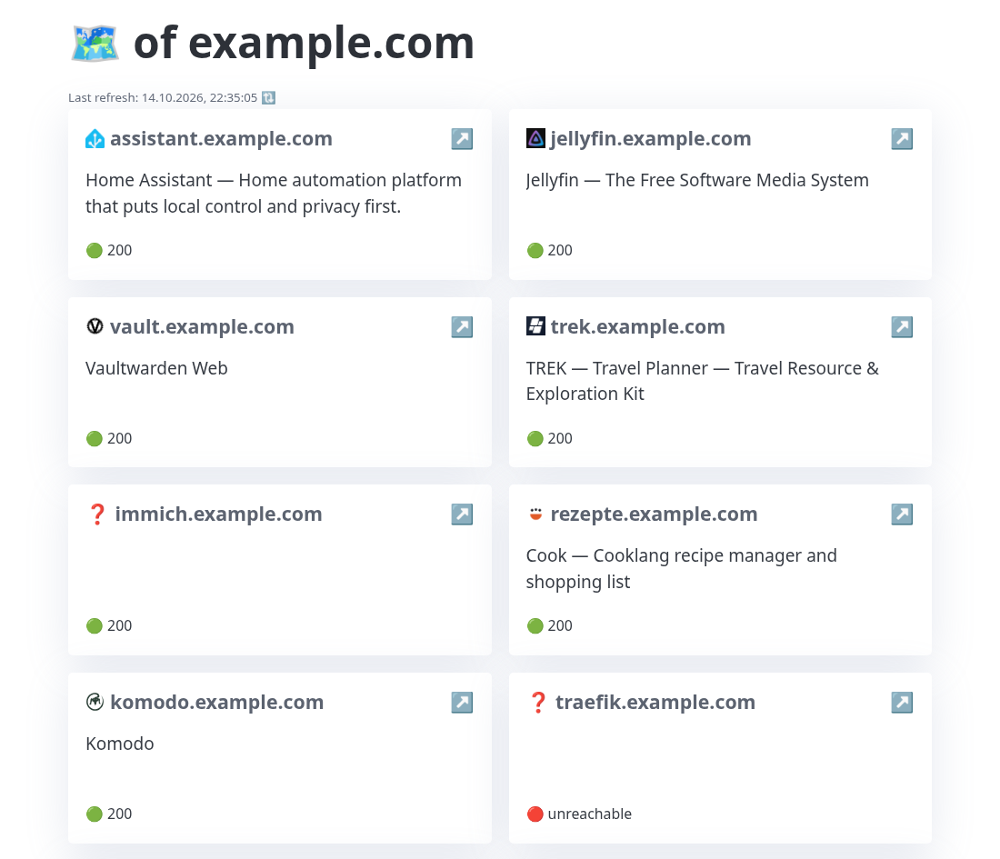

# service-atlas

Minimal service that generates a service overview homepage from Certificate Transparency (CT) logs.

> **Experimental branch:** a port of the Go backend on `main` to Kotlin, compiled to a static binary with GraalVM Native Image. For self-hosting use `main`. How the implementations compare is measured on the [`benchmark`](https://github.com/dkarv/service-atlas/tree/benchmark) branch.



## Philosophy

With AI-assisted programming it has become easy to build large, complicated systems that nobody can maintain or keep a full overview of. This project is a fun counter initiative: every file stays at **150 lines or less**, including the docs, config and vendored CSS, so the whole project can still be read and verified by hand.

<!-- loc:start -->
| File | Lines | Description |
| --- | ---: | --- |
| **Backend** | **256** | |
| `backend/src/main/kotlin/Services.kt` | 130 | crt.sh lookup, probing, cache |
| `backend/src/main/kotlin/Http.kt` | 56 | HTTP client with timeouts and TLS trust |
| `backend/src/main/kotlin/Main.kt` | 55 | HTTP server, API, static files |
| `backend/build.gradle.kts` | 14 | Gradle build definition |
| `backend/settings.gradle.kts` | 1 | Gradle project name |
| **Frontend** | **297** | |
| `frontend/blades.min.css` | 144 | Vendored Blades CSS (Pico fork) |
| `frontend/main.js` | 76 | Loads, sorts and renders the services |
| `frontend/style.css` | 45 | Custom styles on top of Blades |
| `frontend/index.html` | 32 | Page skeleton and card template |
| **Dockerfile** | **23** | |
| `Dockerfile` | 23 | Native image build, distroless container image |
| **Total** | **576** | |
<!-- loc:end -->


## Features

- Derives the base domain from the page's hostname (works behind reverse proxy with `*.yourdomain.com`).
- Queries [crt.sh](https://crt.sh) for all subdomains of that domain.
- Caches results in `./cache/<domain>.json` and refetches once they are older than 1 day.
- Serves a static `index.html` that loads the subdomain list via `/api/subdomains`.
- JSON API: `GET /api/subdomains?domain=yourdomain.com`

No configuration files. Just run and access via your domain. Optionally `SSL_CERT_FILE` adds trusted CA certificates, e.g. of a private CA, as it does for Go.


## Quickstart

### Build & run locally

```bash
cd backend && gradle run
```

Requires JDK 25 and Gradle. There is deliberately no Gradle wrapper, as `gradlew` alone would break the line limit.

Open `http://localhost:8080` in your browser.

### Docker

```bash
docker build -t service-atlas .
docker run --rm -p 8080:8080 -v service-atlas-cache:/app/cache service-atlas
```

The image contains a static musl binary on `distroless/static`. The published `ghcr.io/dkarv/service-atlas` images are built from `main`.


## Native Image settings

- `-Os` optimizes for size, `-O2` made the binary 7 MB larger.
- `--limit-modules` leaves out RMI, JNDI and LDAP, which TLS would otherwise pull in.
- `-R:MaxHeapSize=64m` caps the heap. Without it Serial GC may grow up to 80% of the RAM. The crt.sh response is decoded as a stream, so even a 6 MB heap handled 7 MB of JSON.
- `--install-exit-handlers` lets the binary stop on SIGTERM when it runs as PID 1.


## Differences from the Go version

The JSON API returns the same results, apart from these details:

- Favicon links are resolved with `java.net.URI` (RFC 2396). `../` above the root is kept and a bare `?v=1` href drops the last path segment.
- Only `&amp; &lt; &gt; &quot; &#39;` are unescaped in links, Go handles every HTML entity.
- An empty list is `[]` instead of `null`, and the API sends `application/json` instead of `text/plain`.
- A site that stalls after its headers shows as unreachable instead of showing its status.
- Up to 5 redirects are followed instead of 10, a malformed query (`%zz`) gets a 400.
- Error messages are worded differently, a failed DNS lookup only says `java.net.ConnectException`.
- Like the Go version, every API call rewrites the cache file, so concurrent requests may read a partial file and refresh everything.
